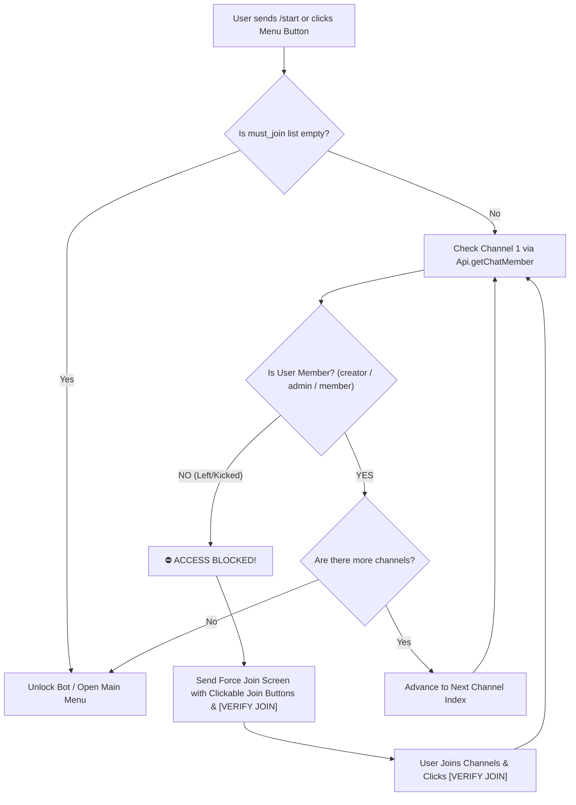
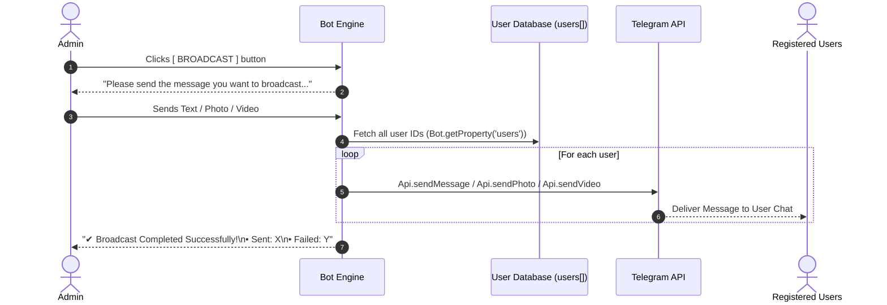

# 👑 Toxic Premium Emoji & Post Builder Bot — Admin Panel Features & System Guide

Yeh document **Toxic Premium Emoji & Post Builder Bot** ke Admin Panel ke sabhi features, unke kaam karne ke tareeqe (workflows), aur vishesh roop se **Force Channel (Must-Join) System** aur **Broadcast System** ki poori detail prastut karta hai.

---

## 📑 Table of Contents (Vishy-Suchi)
1. [Admin Panel Ka Overview & Access Control](#1-admin-panel-overview--access-control)
2. [⚡ Force Channel (Must-Join / FSub) System — Kaise Kaam Karta Hai?](#2-force-channel-must-join--fsub-system)
   - [Supported Channel Types (Public, Private, Request)](#supported-channel-types)
   - [Real-Time Live Anti-Bypass Gate Architecture](#real-time-live-anti-bypass-gate-architecture)
   - [Channel Verification Flow Diagram](#channel-verification-flow-diagram)
   - [Channel Add & Remove Kaise Karein?](#channel-add--remove-kaise-karein)
3. [📢 Broadcast System — Kaise Kaam Karta Hai?](#3-broadcast-system)
   - [User Registration & Tracking Architecture](#user-registration--tracking-architecture)
   - [Supported Message & Media Formats](#supported-message--media-formats)
   - [Broadcast Execution Flow & Delivery Stats](#broadcast-execution-flow--delivery-stats)
4. [📡 Channel Control Panel (Direct Channel Management)](#4-channel-control-panel)
   - [Direct Post Publishing](#direct-post-publishing)
   - [Post Deletion via Message ID / Link](#post-deletion-via-message-id--link)
   - [Admin Rights & Demotion](#admin-rights--demotion)
   - [Strict Security Rule (Bot Channel Delete Nahi Kar Sakta)](#strict-security-rule)
5. [🎨 Custom Emoji Management (Text & Button Emojis)](#5-custom-emoji-management)
6. [📊 Bot Status, Analytics & DB Maintenance](#6-bot-status-analytics--db-maintenance)
7. [Quick Commands & Reference Table](#7-quick-commands--reference-table)

---

## 1. Admin Panel Overview & Access Control

Admin Panel bot ka central control room hai jahan se bot ke owner sabhi settings, channels, users aur custom emojis ko live manage kar sakte hain.

- **Master Admin ID:** `8710308658` (Bot.getProperty("admin_id"))
- **Access Rule:** Bot ke sabhi admin commands aur callback buttons par strict telegram ID validation lagi hui hai:
  ```javascript
  var adminId = "8710308658";
  if (String(user.telegramid) !== adminId) {
    Api.answerCallbackQuery({
      callback_query_id: request.id,
      text: "Unauthorized Access!",
      show_alert: true
    });
    return;
  }
  ```
- **Admin Panel Khone Ka Tareeqa:**
  - Main menu me **`[ 👑 ADMIN PANEL ]`** button dabayein (sirf admin ko dikhta hai), ya
  - Chat me command bhejein: `/menu_admin_panel`

---

## 2. ⚡ Force Channel (Must-Join / FSub) System

**Force Channel (FSub)** bot ka sabse zaroori security aur growth feature hai. Iska maqsad yeh sunishchit karna hai ki **koi bhi user bina aapke channels ko join kiye bot ka ek bhi button ya feature use na kar sake.**

### Supported Channel Types
Bot teen (3) tarah ke channels ko support karta hai:

| Channel Type | Pehchaan (Identifier) | Verification Method | Link Ka Type |
|---|---|---|---|
| **1. Public Channel** | `@channelusername` | `Api.getChatMember` status check | Public Link: `https://t.me/username` |
| **2. Private Channel** | `-100xxxxxxxxxx` (Chat ID) | `Api.getChatMember` status check | Invite Link: `https://t.me/+xxxx` |
| **3. Request Channel** | `-100xxxxxxxxxx` (Chat ID) | Auto-Verify on Click / Request Track | Join Request Link: `https://t.me/+xxxx` |

---

### Real-Time Live Anti-Bypass Gate Architecture

Pehle ke bots me ek baar join karne ke baad user channel leave kar deta tha aur bot ko pata nahi chalta tha. **Is bot me 100% Real-Time Live Check implemented hai:**

1. **/start par Immediate Gate Check:**
   - User jaise hi `/start` bhejta hai, bot pehle membership check (`gate_check_step`) trigger karta hai.
   - Agar user ne saare channels join kar rakhe hain, tabhi Welcome Message aur Main Menu display hota hai.

2. **Har Menu Button Par Live Interception:**
   - User chahe kisi bhi button par click kare (`MAKE POST`, `HELP`, `CONNECT CHANNELS`, etc.), `_catchAll.js` har callback query par pehle user ki live membership check karta hai.
   - **Agar user ne bot use karte-karte beech me channel chhod (leave) diya**, to agla button click karte hi bot access block kar dega aur Join Screen bhej dega!

3. **Sub-Second Fast API Check:**
   - Verification ke liye queue delay ko eliminate kiya gaya hai.
   - Telegram API (`Api.getChatMember`) ka direct callback response ~100–200ms me aata hai, isliye bot super-fast respond karta hai bina kisi lag ke.

4. **Recursive Step Execution:**
   - Bots.Business ke call stack limit (max depth 5) ko dhyaan me rakhte hue channel 1 direct check hota hai aur 3+ channels hone par safe worker runner use hota hai, jisse bot kabhi crash nahi hota.

---

### Channel Verification Flow Diagram



---

### Channel Add & Remove Kaise Karein?

#### Channel Add Karne Ka Process:
1. Admin Panel me **`[ ➕ ADD CHANNEL ]`** par click karein.
2. Channel type select karein:
   - **Public Channel:** Bot ko channel me admin banayein, phir channel ka username bhejein (e.g. `@MyChannel`).
   - **Private Channel:** Bot ko channel me admin banayein, pehle Channel ID bhejein (`-100...`) aur phir Invite Link bhejein.
   - **Join Request Channel:** Channel ID aur Request Invite Link bhejein.
3. Bot automatically verification karke channel ko `must_join` list me save kar lega.

#### Channel Remove Karne Ka Process:
1. Admin Panel me **`[ ➖ REMOVE CHANNEL ]`** par click karein.
2. Bot active channels ki numbered list dikhayega (e.g. `1. @ChannelOne`, `2. @ChannelTwo`).
3. Aap simply channel ka **Number (Index)** ya **Username/ID** type karke send karein.
4. Channel turant must-join list se safely delete ho jayega.

---

## 3. 📢 Broadcast System

**Broadcast System** se Bot Admin apne bot ke sabhi registered users ko ek saath mass message, photo, video, announcements ya promotional offers bhej sakta hai.

### User Registration & Tracking Architecture
- **Automatic User Capture (`_start.js`):**
  Jab bhi koi naya user `/start` press karta hai:
  ```javascript
  if (!User.getProperty("bot_user_registered")) {
    User.setProperty("bot_user_registered", true, "boolean");
    var curCount = Bot.getProperty("total_users_count") || 0;
    Bot.setProperty("total_users_count", curCount + 1, "integer");
  }
  ```
- **Thread-Safe User List:** Users ki unique Telegram IDs bot ke `users` array property me add hoti rehti hain (supports up to 25,000+ registered users).

---

### Supported Message & Media Formats

Broadcast system kisi bhi tarah ke Telegram message payload ko automatically detect aur format karta hai:

1. **Plain Text Messages:** Normal text updates.
2. **HTML Formatted Text:** `<b>bold</b>`, `<i>italic</i>`, `<code>code</code>`, aur Telegram links.
3. **Animated Custom Emojis:** `<tg-emoji emoji-id='...'>👑</tg-emoji>` custom emojis broadcast me bhi fully render hote hain.
4. **Photos with Caption:** Photo bhejne par bot highest quality `file_id` extract karke caption ke saath broadcast karta hai.
5. **Videos with Caption:** Videos bhi unke text captions ke saath sabhi users ko deliver hoti hain.

---

### Broadcast Execution Flow & Delivery Stats



- **Live Delivery Report:** Broadcast khatam hote hi bot admin ko exact statistics bhejta hai:
  - **Sent:** Kitne active users ko successfully deliver hua.
  - **Failed:** Kitne blocked/deleted accounts fail hue (unhe automatically ignore kar diya jata hai bina process roke).

---

## 4. 📡 Channel Control Panel

**Channel Control** ek powerful remote management suite hai un sabhi channels ke liye jahan bot Administrator ke roop me added hai:

### Features:
1. **Direct Post Publishing (`ctrl_act_send`):**
   - Aap bot ke through formatted text, custom animated emojis aur inline buttons directly kisi bhi channel me publish kar sakte hain.
2. **Delete Posts (`ctrl_act_delete`):**
   - Channel ka koi bhi post delete karne ke liye sirf uska Message ID ya Post Link bhejein, bot channel se post ko turant delete kar dega.
3. **Promote / Demote Admins (`ctrl_act_promote` / `ctrl_act_demote`):**
   - Channel me kisi bhi user ko bot ke through Administrator rights de sakte hain ya demote kar sakte hain.
4. **Invite Link Generator (`ctrl_act_link`):**
   - Channel ka naya invite link direct bot panel se generate karein.
5. **Real-Time Admin Status Check (`ctrl_act_status`):**
   - Bot ke paas us channel me kya-kya permissions hain (Post, Edit, Delete, Pin, Invite) uska live report dekh sakte hain.

### ⚠️ Strict Security Rule:
> **Bot Kisi Bhi Channel Ko Khud Se Delete Nahi Kar Sakta!**  
> Bot ko kisi bhi channel ko automatically remove karne ka koi right nahi hai. Agar bot ko channel me admin se hata bhi diya jaye, tab bhi channel database me safe rahega. Channel ko remove karne ka adhikar **sirf aur sirf Admin** ke paas hai.

---

## 5. 🎨 Custom Emoji Management

Bot normal emojis ko animated Telegram custom emojis (`<tg-emoji>`) me convert karta hai. Admin panel se is database ko live customize kiya ja sakta hai:

| Feature | Button | Description |
|---|---|---|
| **Add Text Emoji** | `ADD TEXT EMOJI` | Text me convert hone wala naya emoji aur uska Telegram `custom_emoji_id` jodein. Format: `🔥 5337310516769467285` |
| **Add Button Emoji** | `ADD BTN EMOJI` | Inline button par lagne wala custom emoji icon jodein. |
| **Text Emoji List** | `TEXT EMOJI LIST` | Sabhi active text emojis aur unke IDs ki preview list dekhein. |
| **Button Emoji List** | `BTN EMOJI LIST` | Sabhi button icons ki preview list dekhein. |
| **Remove Emoji** | `REMOVE EMOJI` | Kisi bhi emoji ko uske character ya ID se delete karein. |

---

## 6. 📊 Bot Status, Analytics & DB Maintenance

1. **Bot Status (`STATUS`):**
   - Total Registered Users counter.
   - Total Active Force Join Channels.
   - Custom Text & Button Emojis count.
   - Bot Identity (Username, Title, Bot ID).
2. **Export Users (`EXPORT USERS` / Paginated Directory):**
   - **Total Users Counter:** Header me kul registered users aur current page count display hota hai.
   - **10 Users Per Page (Pagination):**
     - Page 1: Users 1 to 10
     - Page 2: Users 11 to 20
     - Page 3: Users 21 to 30 (aur aage isi tarah)
     - `[ ⬅️ PREV ]` aur `[ NEXT ➡️ ]` navigation buttons.
   - **100% Clickable Profiles & Usernames:**
     - User ka Naam Telegram profile link `<a href="tg://user?id=UID">Name</a>` ke sath clickable hai (tap karte hi user se direct chat khul jati hai).
     - User ka `@username` clickable hai (`https://t.me/username`).
     - Har user ke sath `[ MESSAGE 💬 ]` direct message link diya gaya hai.
     - User ID `<code>...</code>` format me hai jise tap karke copy kiya ja sakta hai.
   - **📥 Full CSV Database Export:**
     - Pagination ke theek neeche `[ 📥 EXPORT FULL CSV FILE ]` button diya gaya hai.
     - Is par click karte hi sabhi users ka complete database CSV format me export ho jata hai:
       `Index,User ID,First Name,Last Name,Username,Direct Profile Link,Registered Date`
3. **Clean DB (`CLEAN DB`):**
   - Database se orphan ya invalid entries ko clean aur optimize karein.

---

## 7. Quick Commands & Reference Table

| Command / Callback | Role / Functionality | Accessible By |
|---|---|---|
| `/start` | Bot entry point + Real-time FSub membership verification | All Users |
| `menu_admin_panel` | Open Main Admin Control Panel | Admin Only (`8710308658`) |
| `admin_status` | View bot statistics, user count & system info | Admin Only |
| `admin_broadcast` | Initiate mass broadcast to all users | Admin Only |
| `admin_add_channel` | Add new Public, Private, or Request Force Channel | Admin Only |
| `admin_list_channels`| View all currently active Force Join channels | Admin Only |
| `admin_remove_channel`| Remove a Force Join channel | Admin Only |
| `admin_channel_control`| Access Channel Control Suite | Admin Only |
| `admin_add_text_emoji`| Map standard emoji to Telegram custom animated emoji | Admin Only |
| `admin_list_text_emojis`| View all custom text emoji mappings | Admin Only |
| `admin_remove_emoji`| Delete custom emoji from database | Admin Only |
| `admin_export_users` | Paginated User Directory (10 users/page) with Clickable Profiles | Admin Only |
| `admin_export_csv` | Generate & Export Full Users Database to CSV file | Admin Only |
| `admin_clean_db` | Optimize & clean bot database properties | Admin Only |
| `back_to_main` | Exit Admin Panel and return to Main User Menu | All Users |

---
*Created for **Toxic Advanced Emoji & Post Builder Bot** on Bots.Business Platform.*
